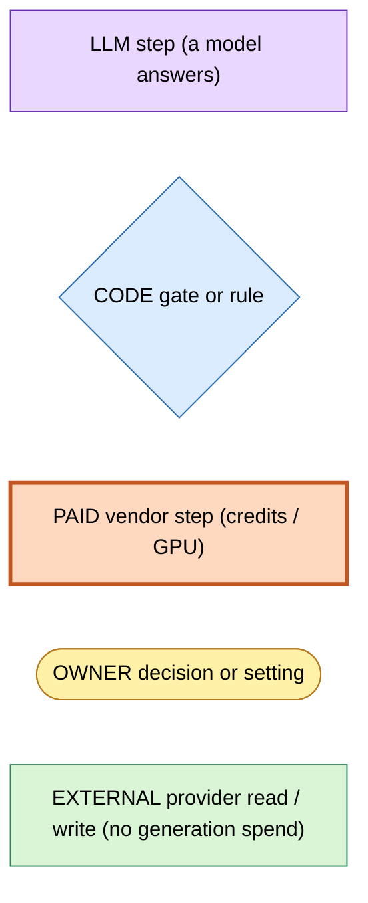

# Runtime flow of the AMN-AI backend (end to end)

What happens, in order, from the moment the studio process starts until a film is on a
YouTube channel and measured; who decides at every step; where money is spent and what gates
it; and what happens when a step fails. Read from the working tree on 2026-10-12 (branch
`codex/simple-pixel-studio`, HEAD `3d49e9a` plus uncommitted work of other sessions). Every
claim carries `file:line`; paths are relative to the repository root unless they start with
`app/`, which means `backend/app/`.

Companion documents: `STATS.md` (counts), `inventory.json` (every function),
`subsystems/*.md` (one module family each, in depth). This file is the cross-cutting spine
that ties them together.

## 0. How to read this file

**Who acts** (column used in every step table):

| tag | meaning |
|---|---|
| `LLM:<Role>/<call site>` | a language model answers through `app.agents.services.run_agent_task` (app/agents/services.py:733), via the named call site |
| `CODE` | deterministic Python: a rule, threshold, cap, state machine or FFmpeg |
| `PROVIDER:<name>` | an external vendor does the work or answers (RunPod GPU, ElevenLabs, YouTube, a web site) |
| `OWNER` | the human Owner, via a decision card, an approval, a button or a setting |

**Decided-by vocabulary** (used in section 9): `LLM`, `LLM_CHECKED_BY_CODE`, `CODE_RULE`,
`OWNER`, `CONFIG`, `EXTERNAL`. **Trust vocabulary** for an LLM answer: `FINAL`,
`CHECKED_BY_CODE`, `ADVISORY`, `INFORMATIONAL`.

**Money**: two kinds of spend exist at runtime.

1. *Model tokens.* Every LLM run passes the day's token ceiling and the USD budget inside the
   gateway before the provider is called (`may_run_agent`, app/agents/services.py:781; refusal
   raised at app/agents/services.py:829). This is true for every `LLM` step below and is not
   repeated per row.
2. *Media generation* (stills, clips, narration) and GPU time. These are the "paid" steps.
   They pass the Policy Kernel `may_act` (app/services.py:1410) including the Owner's
   `paid_media_approval` rule for `PAID_MEDIA_STEPS` (app/services.py:606, rule described at
   app/services.py:1445-1457), a budget hold (`reserve_spend`, app/economy/budget.py:473), the
   film's ceiling (`check_film_ceiling`, app/media/shooting_sheet.py:2673), the account balance
   rule, and the film's purchase lease (`film_purchase_lease`,
   app/media/shooting_sheet.py:2048).

**Mermaid legend** (both pipeline charts use the same classes):

---

## 1. Process start

### 1.1 Launcher chain

| # | step | function (file:line) | who acts | notes |
|---|---|---|---|---|
| S1 | `python start.py` at the repo root re-execs the real launcher under `uv run --locked` | `main`, start.py:13 (Popen at start.py:21-24) | CODE | Ctrl+C in the shared console is swallowed so the inner launcher can finish its clean stop (start.py:31-34) |
| S2 | Every child process is put in a Windows Job Object that dies with the launcher | `tie_to_this_window`, scripts/start.py:557 | CODE | a closed window or killed launcher leaves nothing running (scripts/start.py:31-33) |
| S3 | `uv sync --locked` | scripts/start.py:590-598 | CODE | a failed step raises `StepFailed` and the studio is not started (scripts/start.py:83, 652-655) |
| S4 | Bootstrap: `.env`, migrations, seed data | scripts/start.py:600-604 (runs scripts/bootstrap.py) | CODE | idempotent |
| S5 | Frontend bundle built only if sources are newer | `frontend_needs_build`, scripts/start.py:110; `build_frontend`, scripts/start.py:118 | CODE | |
| S6 | Preflight printed from the studio's own database, plus the FFmpeg filter/encoder report | `preflight_report`, scripts/start.py:196; `toolchain_report`, scripts/start.py:164 | CODE | reads only; no vendor call (scripts/start.py:197-198) |
| S7 | Live headquarters graphics (Unreal) start only with `--graphics` | `prepare_graphics`, scripts/start.py:526 | OWNER (flag) | default off by the Owner's instruction of 2026-10-04 (scripts/start.py:26-28) |
| S8 | The server runs in its own process group: `scripts/run.py` → `uvicorn.run("app.main:create_app", factory=True, timeout_graceful_shutdown=30)` | `serve`, scripts/start.py:429; scripts/run.py:45-57 | CODE | own group so only one clean stop request ever reaches uvicorn (scripts/start.py:327-331) |

### 1.2 `create_app` and the lifespan start-up sequence

`create_app` (app/main.py:249) configures logging, opens the engine, builds the registry, the
credential vault and **the stage runners once per process**
(`app.state.stage_runners = build_stage_runners(...)`, app/main.py:700;
`build_stage_runners`, app/runbook/stages.py:6330). The `lifespan` (app/main.py:267) then runs:

| # | start-up step | file:line | who | on failure |
|---|---|---|---|---|
| L1 | Database revision must equal the migrations' head; `owner_policy` row must exist | app/main.py:286-296 | CODE | `RuntimeError`: the studio refuses to start |
| L2 | Vault health read once; a key that cannot be read is reported, not fatal | app/main.py:299 | CODE | page still comes up (REL-06) |
| L3 | Provider registry loaded from DB + seeded Ollama | app/main.py:301-302 | CODE | |
| L4 | Owner decision cards seeded and refreshed (cards whose condition cleared while down are closed) | app/main.py:306-310 | CODE → cards for OWNER | logged, start continues |
| L5 | Demo mode only: every vendor replaced, outbound network blocked | app/main.py:312-326 | CONFIG (`STUDIO_DEMO_MODE`) | |
| L6 | `clear_shutdown` so a restart in place is not born stopped | app/main.py:329 | CODE | |
| L7 | Outbox dispatcher loop started (every 1 s) | `dispatch_outbox`, app/main.py:337-354 | CODE | errors logged, loop continues |
| L8 | Provider catalogue refresher loop (if enabled) | app/main.py:356-380 | CODE + PROVIDER | logged |
| L9 | Unreal bridge loop (if a remote-control target is configured) | app/main.py:384-387 | CODE | |
| L10 | **Worker lock**: one worker per database file (`<db>.lock`, OS lock) | `acquire_worker_lock`, app/workflows/worker.py:815; app/main.py:397-412 | CODE | second process serves the page and runs no worker |
| L11 | Film purchase leases left by dead processes are reclaimed, budget holds released, one letter to the Owner each | `reclaim_abandoned_leases`, app/media/shooting_sheet.py:2204; app/main.py:418-429 | CODE | logged |
| L12 | RunPod GPU guard at BOOT (orphan sessions forced off), then its own loop | `run_gpu_guard`, app/providers/runpod/gpu_guard.py:254; app/main.py:434-471 | CODE + PROVIDER:RunPod | runs even under STOP AUTONOMIE because it only stops spending (app/providers/runpod/gpu_guard.py:3-6) |
| L13 | Scheduled jobs ensured (idempotent by name; see 3.4) | `ensure_scheduled_job`, app/workflows/services.py:681; app/main.py:475-575 | CODE | |
| L14 | Task handlers built and the worker loop started | `build_task_handlers`, app/workflows/worker.py:162; `run_worker`, app/main.py:581-613 | CODE | a pass that raises is logged; the third consecutive failure is one event + one letter (`record_pass_failure`, app/operations.py:81) |

### 1.3 Background loops in the running process

| loop | function | interval | behind STOP AUTONOMIE? | LLM? |
|---|---|---|---|---|
| Outbox → WebSocket broadcast | `dispatch_pending_outbox` (app/workflows/publisher.py:127) via app/main.py:337 | 1 s | no (it only broadcasts committed events) | no |
| Durable worker | `worker_pass` (app/workflows/worker.py:721) via app/main.py:581 | `worker_interval_seconds` = 30 s (app/config.py:457) | yes: `scheduler_tick` and `claim_task` refuse (app/workflows/services.py:814, 366, 376) | through task handlers and the mail round |
| RunPod GPU guard | `run_gpu_guard` / `guard_intervals` / `next_interval` (app/main.py:448-471) | 60 s while a session is open, else 600 s (docs/project/16_DECISION_LOG.md:4202) | no (ADR-GPU-OFF-ALWAYS) | no |
| Provider catalogue refresh | `refresh_due_catalogs` (app/main.py:358-378) | `provider_catalog_poll_seconds` 60 s, refresh every 6 h (app/config.py:504-507) | no | no |
| Unreal bridge | `run_unreal_bridge` (app/main.py:385) | own | no | no |

---

## 2. Process stop and restart

### 2.1 Clean stop (Ctrl+C or a restart script)

| # | step | file:line | who |
|---|---|---|---|
| T1 | The launcher catches every Ctrl+C and asks the server **once** with CTRL_BREAK to its process group | `serve.interrupted`, scripts/start.py:457-474; `ask_server_to_stop`, scripts/start.py:340 | CODE |
| T2 | uvicorn waits up to 30 s for open connections | `GRACEFUL_SHUTDOWN_SECONDS`, scripts/run.py:18 | CODE |
| T3 | Lifespan `finally`: `request_shutdown(engine)` first, so the running day hears it at its next boundary | app/main.py:622; `request_shutdown`, app/runbook/services.py:342 | CODE |
| T4 | Paid loops read `stop_requested` (which honours the shutdown) before every scene and retry; the day ends `INTERRUPTED`, never mid-purchase | app/runbook/services.py:377, 1478-1488, 1529-1546 | CODE |
| T5 | Dispatcher, worker, catalogue, Unreal and guard tasks awaited | app/main.py:624-640 | CODE |
| T6 | RunPod `force_off(SHUTDOWN)` (20 s bound) | app/main.py:641-657; `force_off`, app/providers/runpod/gpu_session.py:1274 | CODE + PROVIDER:RunPod |
| T7 | Worker lock released, demo patches undone, engine disposed | app/main.py:661-667 | CODE |
| T8 | Launcher then stops graphics and runs `scripts/runpod_gpu_off.py --reason LAUNCHER_STOP` (45 s; `--fast` 4 s on a closing window) | `serve` finally, scripts/start.py:513-522; `runpod_gpu_off`, scripts/start.py:397 | CODE + PROVIDER:RunPod |

A closed console window takes the fast path: GPU off first ("Money first"), graphics fast,
2.5 s for the server (`window_closed`, scripts/start.py:476-490).

### 2.2 Restart without the Owner

| script | what it does | file:line |
|---|---|---|
| `scripts/restart.py` | finds the `scripts\start.py` python process, sends Ctrl+C to its console from a child process (never its own), falls back to CTRL_BREAK after `--break-after` s, waits, starts a new detached console, confirms `/health/live` | docstring scripts/restart.py:1-21; `stop` scripts/restart.py:120; `start` scripts/restart.py:151 |
| `scripts/restart_when_quiet.py` | polls a read-only **copy** of the DB every 10 s and restarts only when the newest GPU event is `runpod.gpu_off_verified` **and** no `FILM_CONTINUE` task is `CLAIMED` | docstring scripts/restart_when_quiet.py:1-18; condition scripts/restart_when_quiet.py:154 |

Why the second condition exists: a restart between two GPU steps of one repair round cancelled
paid stills on 2026-10-12 (scripts/restart_when_quiet.py:4-9). Restarts themselves are an Owner
rule of 2026-10-12 recorded in docs/project/16_DECISION_LOG.md:57.

### 2.3 What resumes after a restart

| mechanism | file:line | who |
|---|---|---|
| A task whose lease lapsed with attempts left is re-claimed by the queue; one with none left is dead-lettered `INTERRUPTED` with a letter (day or film continuation only) | `claim_task`, app/workflows/services.py:333; `sweep_interrupted_tasks`, app/workflows/services.py:399; `announce_interrupted`, app/workflows/worker.py:669 | CODE |
| The day cut off by the restart is resumed: watchdog pass `resume_interrupted_day` (order 20) queues one `DAILY_RUN` with `resume_of`; completed stages are **replayed from the record**, nothing bought twice | app/workflows/passes/resume_interrupted_day.py:29-93; `resumable_run`, app/runbook/services.py:1064; `resume_runners`, app/runbook/services.py:1079; handler branch app/workflows/worker.py:212-239 | CODE |
| Films and serial episodes left standing are walked once after each start | passes `owner_choice_continuation` (app/workflows/passes/owner_choice_continuation.py:57), `serial_unfilmed` (app/workflows/passes/serial_unfilmed.py:64) | CODE |

---

## 3. The durable workflow engine

### 3.1 Queue primitives

| primitive | file:line | rule |
|---|---|---|
| `enqueue_task` | app/workflows/services.py:277 | idempotent by `idempotency_key`; `not_before` holds a task in the queue (no sleeping thread) |
| `claim_task` | app/workflows/services.py:333 | refuses while `autonomy_stopped`; orders by priority then due time; each claim gets its own lease token `<worker>:<uuid>` (app/workflows/services.py:394) |
| `LeaseKeeper` | app/workflows/worker.py:513 | renews the handler's lease every half lease (lease = 3600 s, app/workflows/worker.py:144); a lost lease means the outcome is refused at completion (`_lease_lost`, app/workflows/worker.py:573) |
| `work_once` | app/workflows/worker.py:604 | claims one task; `NonRetryable` → dead letter; other exceptions → `fail_task(retryable=True)` |
| `scheduler_tick` | app/workflows/services.py:791 | turns every due active job into one `TaskQueueItem` keyed `scheduled:<job>:<slot>`; refuses under the stop; a missed wall-clock slot fires once |

### 3.2 One worker pass (`worker_pass`, app/workflows/worker.py:721)

1. Nothing at all while the studio shuts down (app/workflows/worker.py:739-740).
2. Dead tasks named and the Owner told (`announce_interrupted(sweep_interrupted_tasks(...))`,
   app/workflows/worker.py:741).
3. Shooting-sheet blocker scan (`SCAN_FILM_SHEETS`, throttled to
   `sheet_blocker_scan_seconds` = 300 s, app/workflows/worker.py:461-475, app/config.py:56).
4. `scheduler_tick` (app/workflows/worker.py:747).
5. Up to `TASKS_PER_PASS` = 3 tasks claimed and run (app/workflows/worker.py:153, 749-755).
6. The mail round `correspondence_round` when a registry exists (app/workflows/worker.py:757-760;
   see 7.3). **This is the only LLM work the worker does outside a task handler.**

### 3.3 Task handlers (`build_task_handlers`, app/workflows/worker.py:162; table at app/workflows/worker.py:497-510)

| task type | handler (worker.py line) | calls | who acts | LLM? |
|---|---|---|---|---|
| `DAILY_RUN` | `daily_run` :171 | `execute_daily_run` app/runbook/services.py:1359 | CODE orchestrates; LLM inside stages | yes (sections 4-6) |
| `FILM_CONTINUE` | `film_continue` :326 | `continue_film` app/runbook/stages.py:5430 | CODE + LLM + PAID | yes |
| `WEEKLY_REVIEW` | `weekly_review` :366 | `execute_weekly_review` app/runbook/weekly.py:271 | LLM:Director | yes (call site) |
| `TRENDS_REFRESH` | `trends_refresh` :380 | `refresh_trends` app/analytics/trends.py:132 | PROVIDER (trends feed) | no |
| `MODEL_RESEARCH` | `model_research` :412 | `research_all` app/media/model_research.py:530 → `research_models` :205 | LLM:steward + PROVIDER pages | yes |
| `MODEL_REVIEW` | `model_review` :407 | `review_models(full=False)` app/integrations/lifecycle.py:295 | CODE ("generates nothing", lifecycle.py docstring) | no |
| `DIRECTOR_LOOP` | `director_loop` :385 | `direct_company` app/agents/command.py:866 → `_choose` :1083 | LLM:Director over computed matters | yes |
| `DIRECTOR_REPAIR` | `director_repair` :400 | `execute_repair` app/agents/repairs/desk.py:514 | CODE (Policy Kernel asked again) | no static path |
| `WATCHDOG` | `watchdog` :419 | `run_watchdog` app/workflows/watchdog.py:803 | CODE (+ PROVIDER GETs) | no |
| `BACKUP` | `backup` :429 | `run_backup_job` app/backup.py:540 | CODE | no |
| `SCAN_FILM_SHEETS` | `scan_sheets` :461 | `scan_sheet_issues` app/media/blocker_repair.py:950 | CODE | no |
| `FILM_SHEET_REPAIR` | `sheet_repair` :445 | `process_sheet_repair` app/media/blocker_repair.py:727 → `director_assignment` :557 | LLM:Director (assignment) + CODE tool | yes |

A task type with no handler is dead-lettered with that reason (app/workflows/worker.py:627-635).

### 3.4 Scheduled jobs (seeded in the lifespan)

| job name | workflow type | schedule | active from birth? | file:line |
|---|---|---|---|---|
| `daily_main` | `DAILY_RUN` | wall clock `daily_run_hour_local` = **05:00** in `Europe/Bucharest` (app/config.py:464, 52), CATCH_UP | **No: dormant until the Owner activates it** | app/main.py:475-487 |
| `watchdog` | `WATCHDOG` | every 600 s (app/config.py:493), SKIP | yes | app/main.py:491-499 |
| `weekly_review` | `WEEKLY_REVIEW` | 7 days, first after 1 h | yes | app/main.py:504-512 |
| `trends_daily` | `TRENDS_REFRESH` | daily, first after 120 s, only if `trends_enabled` | yes | app/main.py:516-525 |
| `model_research_weekly` | `MODEL_RESEARCH` | 7 days, first after 2 h, not in demo | yes | app/main.py:527-536 |
| `model_review_daily` | `MODEL_REVIEW` | daily, first after 15 min | yes | app/main.py:541-549 |
| `director_loop` | `DIRECTOR_LOOP` | every 6 h (four a day), first after 30 min | yes | app/main.py:553-561 |
| `backup` (BACKUP_JOB_NAME) | `BACKUP` | wall clock `backup_hour_local` = 03:30 (app/config.py:123) | yes | app/main.py:566-575 |

`ensure_scheduled_job` never flips an existing job's `is_active`; it only follows a changed hour
(app/workflows/services.py:694-718). Activating a job is an Owner command recorded as
`workflow.job_activated` (`set_job_active`, app/workflows/services.py:748; route
`POST /api/v1/scheduler/jobs/{job_id}/active`, app/workflows/router.py:147).

### 3.5 What starts production work (the only doors)

| trigger | path | who decides |
|---|---|---|
| **05:00 day** | `daily_main` job fires → `DAILY_RUN` → `daily_run` (app/workflows/worker.py:171) | OWNER (activated the clock) + CODE (slot) |
| **The Owner's start button** ("Pornește rularea de azi") | frontend `start-run-btn` (frontend/src/main.js:6290) → `POST /api/v1/runbook/runs` (app/runbook/router.py:80) → `start_daily_run` (app/runbook/services.py:1291): refuses under safe mode, stop, or a day already pending; queues `DAILY_RUN` `manual=True`, priority 10 | OWNER |
| **The Owner's yes on a paid step** | `decide_approval` (app/services.py:937) queues `FILM_CONTINUE` in the same transaction (app/services.py:984-998) | OWNER |
| **Owner card answers / take decisions / sheet choices** | `queue_film_continue` (app/services.py:645) from app/decisions/producers/redo_cap.py:233, app/media/assembler.py:9808, app/media/shooting_sheet.py:487 | OWNER |
| **Studio's own continuation of unfinished work** | `queue_film_continue` from the serial stage (app/story/serial_stage.py:328), the ladder (app/runbook/stages.py:1696), the Director's next QC round (app/runbook/stages.py:4182), the sheet repair (app/media/blocker_repair.py:634) and the watchdog passes (app/workflows/passes/director_qc_review.py:176, ladder_retry.py:210, owner_choice_continuation.py:181, serial_unfilmed.py:226) | CODE |
| **Day resume after a restart** | `resume_interrupted_day` pass (section 2.3) | CODE |

`queue_film_continue` only queues in PRODUCTION (app/services.py:645 docstring). A new day of
work is never started by an LLM: the Director's loop and reviews write letters and repairs, not
`DAILY_RUN` tasks (no `DAILY_RUN` enqueue exists in app/agents; the enqueuers are
app/runbook/services.py:1326, app/workflows/worker.py:303, the resume pass at
app/workflows/passes/resume_interrupted_day.py:65 and the scheduler tick for `daily_main`; the
only `enqueue_task` in app/agents queues `DIRECTOR_REPAIR`, app/agents/repairs/desk.py:368).

### 3.6 The `DAILY_RUN` handler's own rules (app/workflows/worker.py:171-324)

| rule | file:line | decided by |
|---|---|---|
| A retry queued for yesterday is skipped | worker.py:178-185 | CODE |
| A resume is only for today's newest INTERRUPTED run with nothing after it | worker.py:212-239 | CODE |
| The clock never repeats a day that ran (COMPLETED/PARTIAL) or was cut off (INTERRUPTED/RUNNING); the Owner's manual run may | worker.py:240-260 | CODE / OWNER |
| At most `daily_max_attempts` = 3 per date (app/config.py:470) | worker.py:261-268 | CONFIG |
| A retryable day (blocked preflight, or a transient fault that cost the films) is re-queued after `daily_retry_seconds` = 1800 s | worker.py:290-323; `retryable_outcome`, app/runbook/services.py:404-424 | CODE |
| Safe mode active → `NonRetryable` dead letter | worker.py:279-281 | CODE |

### 3.7 The watchdog (`run_watchdog`, app/workflows/watchdog.py:803)

Skips everything under STOP AUTONOMIE (app/workflows/watchdog.py:822-839). Built-in parts, in
order, each "repairs for free or proposes a card" (app/workflows/passes/__init__.py:28-33):

| order | part | file:line | money |
|---|---|---|---|
| 1 | fail renders stuck past `render_stuck_after_seconds` (3 h) | `_fail_stuck_renders`, app/workflows/watchdog.py:161 | none |
| 2 | reconcile uncertain publications (bounded, then handed to the Owner) | `_reconcile_publications`, watchdog.py:301 | YouTube GETs |
| 3 | follow YouTube processing for 6 h after upload | `_follow_processing`, watchdog.py:439 | YouTube GETs |
| 4 | report lapsed task leases (never touches them) | `_lapsed_leases`, watchdog.py:496 | none |
| 5 | release stale budget holds | `release_stale_reservations` (watchdog.py:869-876) | none |
| 6 | reclaim abandoned film purchase leases | watchdog.py:883-890 | none |
| 7 | collect SUBMITTED paid tasks by id (GET only, never a POST) | `_collect_paid_tasks`, watchdog.py:568 | none (collects what was paid) |
| 8 | close days nobody runs any more → INTERRUPTED + letter | `_interrupted_days`, watchdog.py:621 | none |
| 9 | release scene holds caused by the studio's own malformed request | watchdog.py:913-922 | none |
| 10 | RunPod `/run` holds with no job id → release or Owner card | watchdog.py:926-934 | none |
| 11 | retire letters to the Owner whose question no longer waits | watchdog.py:942-955 | none |
| 12 | delete failed renders' intermediates (only if the Owner turned it on) | `_sweep_failed_intermediates`, watchdog.py:602 | none |
| then | registered passes in `order` (`_run_registered_passes`, watchdog.py:698) | see below | none |

Registered passes (each in its own try; stop re-read before each; rules at
app/workflows/passes/__init__.py:28-50):

| order | pass | file:line | effect |
|---:|---|---|---|
| 20 | `resume_interrupted_day` | app/workflows/passes/resume_interrupted_day.py:29 | queues the day's resume |
| 120 | `vendor_plan_licence` | app/workflows/passes/vendor_plan_licence.py:17 | reads the ElevenLabs plan, records the voice licence (GET) |
| 130 | `licence_release` | app/workflows/passes/licence_release.py:19 | makes private-for-licence uploads public once licensed |
| 140 | `character_references` | app/workflows/passes/character_references.py:171 | registers character portraits as bible references (free) |
| 140 | `restore_retired_takes` | app/workflows/passes/restore_retired_takes.py:42 | gives back takes a redo retired and then delivered nothing for |
| 145 | `replaced_boards` | app/workflows/passes/replaced_boards.py:19 | closes storyboards a story repair replaced |
| 150 | `owner_choice_continuation` | app/workflows/passes/owner_choice_continuation.py:57 | walks films left standing, once |
| 155 | `ladder_retry` | app/workflows/passes/ladder_retry.py:66 | re-runs the Director's rewrite ladder that failed to land |
| 160 | `director_qc_review` | app/workflows/passes/director_qc_review.py:74 | puts every undecided failed QC report before the Director (retry 60 min, max 24 tries, PRODUCTION only; :42-53, :91) |
| 160 | `serial_unfilmed` | app/workflows/passes/serial_unfilmed.py:64 | builds and walks approved serial episodes left without a film |
| 170 | `training_set` | app/workflows/passes/training_set.py:68 | appends approved takes and their exact prompts to a LoRA manifest |

### 3.8 The outbox

Events written with `append_event_with_outbox` (app/workflows/services.py:102) are claimed and
committed in a thread, then broadcast to WebSocket clients (`dispatch_pending_outbox`,
app/workflows/publisher.py:127; `claim_pending_outbox`, publisher.py:63). Nobody hears of an
event whose row did not commit (app/main.py:340-341). The day announces each stage start and
retry this way (`_announce`, app/runbook/services.py:638).

---

## 4. The daily run skeleton (`execute_daily_run`, app/runbook/services.py:1359)

Normative source: docs/architecture/39_DAILY_AUTONOMOUS_RUNBOOK.md (sections 1-12).

**Stage order** (`STAGES`, app/runbook/services.py:76-90): `preflight`, `performance_intake`,
`idea_generation`, `research_and_verification`, `selection`, `script_and_storyboard`,
`serial_queue`, `media`, `edit_and_qc`, `publish`, `post_run`, `daily_log`, `serial_next`.

| mechanism | file:line | decided by |
|---|---|---|
| Safe mode active → refuse the day | app/runbook/services.py:1394-1399 | CODE |
| Empty media defaults auto-filled from the account's catalogue, then preflight | `finish_media_setup` :1345 (called :1405); `run_preflight`, app/runbook/preflight.py:1356 (called :1406) | CODE |
| Row written RUNNING at the start, updated per stage | `_begin_run` :931 (called :1449); `_progress` :972 | CODE |
| Yesterday's log closed first (the serial stage needs it) | `_close_previous_day` :830 (called :1672) | CODE |
| Before every stage: shutdown → INTERRUPTED; Owner stop → BLOCKED, no fault, no letter | :1478-1498 | CODE / OWNER |
| A failure blocks only the stages that need it (`STAGE_PREREQUISITES` :122-135) | `_blocked_by` :563 (used :1500) | CODE |
| Each stage wrapped by `keep`: the Owner's autonomy mode asked for that stage's action/tier (`STAGE_ACTIONS`, app/runbook/stages.py:256-268); refused → SKIPPED, not BLOCKED | `mode_refusal`, app/runbook/stages.py:271 (called :6361) | CODE (OWNER's mode setting) |
| Transient faults retried in place: 3 times, backoff 20/40/80 s | `_run_with_retries` :586; app/config.py:477-478 | CODE |
| HARD fault in `media`, `publish`, `daily_log` (or a DB integrity error anywhere) opens safe mode and sets the stop | `SAFE_MODE_STAGES` :160; `_open_safe_mode` :657 (called :1876) | CODE |
| Day closed from the event stream (counted, never narrated) | `_close_the_day` :784 (called :1688); `close_daily_log`, app/story/services.py:394 | CODE |
| Status derived from stages, never written by a caller | `_derive_status` :773; :1728-1740 | CODE |
| One Director letter to the Owner after the last attempt only | `letter_to_owner`, app/agents/director.py:469 (called :1810) | CODE (fixed text, signed "Sarah") |

`STAGE_ACTIONS` tiers (app/runbook/stages.py:256-268): T0 `performance_intake`; T1
`idea_generation`, `selection`, `script_and_storyboard`, `serial_queue`, `edit_and_qc`,
`post_run`, `serial_next`; T2 `research_and_verification`, `media`; T3 `publish`. Tier semantics
come from docs/architecture/31_GOVERNANCE_APPROVAL_POLICY.md and
docs/architecture/51_AUTONOMY_MODE_SEMANTICS.md.

---

## 5. Pipeline (a): the factual short

Each row: the runbook stage it belongs to, the function, who acts, money and its gate, and what
happens on failure. "Stage outcome" vocabulary is `COMPLETED` (ran), `SKIPPED` (could not run),
`BLOCKED`, `FAILED` (app/runbook/stages.py:7-15).

### 5.1 `performance_intake` (runbook §2)

| # | step | function | who acts | money / gate | on failure |
|---|---|---|---|---|---|
| F1 | Measure every real publication per channel, each through its own bound account | `_performance_intake`, app/runbook/stages.py:391; `measure_channel_publications`, app/analytics/services.py:355 | PROVIDER:YouTube Analytics + CODE | no spend; T0 | no usable account → SKIPPED (stages.py:442-450); an account refusal is recorded once, not retried per film (analytics/services.py:355 docstring) |

### 5.2 `idea_generation` (runbook §3)

| # | step | function | who acts | money / gate | on failure |
|---|---|---|---|---|---|
| F2 | Skip if the pool already holds `IDEA_POOL_TARGET` = 6 candidates | app/runbook/stages.py:332, 341-355 | CODE | none | — |
| F3 | Refresh trends if stale | `refresh_trends` (stages.py:358-359) | PROVIDER:trends feed | none | recorded, not fatal |
| F4 | Lead Researcher proposes topics | `propose_topics`, app/research/agent.py:398 (called stages.py:361) | **LLM:LeadResearcher/`propose_topics`** | tokens | schema per candidate, duplicate subject refused (`_too_similar`, research/agent.py:506), thesis/score refusals (`idea_rejections`, research/agent.py:522); a refused proposal is COMPLETED with 0, never fatal (stages.py:366-372) |

### 5.3 `research_and_verification` (runbook §4)

| # | step | function | who acts | money / gate | on failure |
|---|---|---|---|---|---|
| F5 | Ask the mode whether pages may be fetched (EXTERNAL_READ, T2) | `mode_refusal(..."research.fetch_page")`, stages.py:559 | CODE | none | refused → verify only what is held, fetch nothing (stages.py:554-558) |
| F6 | Re-test authorised hosts not tested for a week | `retest_stale_hosts`, app/research/service.py:379 (stages.py:564) | CODE + PROVIDER:web | none | logged only |
| F7 | Researcher names pages for up to `research_candidates_per_day` = 4 topics × 4 pages; code fetches them | `_gather_for_candidates`, stages.py:479; `gather_sources`, app/research/agent.py:707 (called stages.py:527) | **LLM:LeadResearcher/`gather_sources`** + PROVIDER:web | tokens | pages found by the sites' own search win over guessed addresses (research/agent.py:707 docstring); a topic that failed today is not retried today (stages.py:496-506) |
| F8 | Extract atomic claims from up to 5 unread sources | `agent_extract_claims`, app/factual/agent_pipeline.py:208 (stages.py:592) | **LLM:LeadResearcher/`agent_extract_claims`** | tokens | unparseable answer → that source is skipped today, not the day (stages.py:593-599) |
| F9 | A *different* agent verifies up to 24 claims, CRITICAL first | `agent_verify_claim`, app/factual/agent_pipeline.py:357 (stages.py:622) | **LLM:FactChecker/`agent_verify_claim`** | tokens | a SUPPORTED/REFUTED verdict must quote the source verbatim or the quote is thrown away (agent_pipeline.py:409-420); refusal → claim stays UNVERIFIED |

### 5.4 `selection` (runbook §5)

| # | step | function | who acts | money / gate | on failure |
|---|---|---|---|---|---|
| F10 | A topic already in production keeps the day | `topics_in_production`, stages.py:670 (used :764-776) | CODE | none | — |
| F11 | Shortlist = topics with ≥1 SUPPORTED claim | stages.py:777-804 | CODE | none | none → COMPLETED "nothing true to produce" (stages.py:833-855) |
| F12 | The Director chooses when the shortlist has >1 entry | `choose_topic`, app/agents/director.py:195 (stages.py:808-812) | **LLM:Director/`choose_topic`** | tokens | a choice not on the list is refused (director.py:234-236); fallback is the deterministic `novelty_score` order (stages.py:781, 815-818) |
| F13 | First producible candidate selected | `select_topic`, app/factual/services.py:113 (stages.py:822) | CODE | none | `TopicNotProducible` → next candidate |

### 5.5 `script_and_storyboard` (runbook §6)

| # | step | function | who acts | money / gate | on failure |
|---|---|---|---|---|---|
| F14 | Which topic owes a script, with the last review's notes | `script_work`, stages.py:861 | CODE | none | — |
| F15 | Scriptwriter drafts from SUPPORTED claims only; every scene cites claim ids | `agent_write_script`, app/factual/agent_pipeline.py:642 (stages.py:1016) | **LLM:ScriptWriter/`agent_write_script`** | tokens | a fabricated citation fails the whole draft (`ScriptRejected`, agent_pipeline.py:773-910); topic's room closes for today, day continues (stages.py:1062-1072) |
| F16 | Story review: computed checks decide failures; the Director's opinion is asked only when all pass | `review_story`, app/factual/story_review.py:312; `_ask_director` :544 | CODE + **LLM:Director/`_ask_director`** | tokens | FATAL check `every_scene_is_attributed` (story_review.py:78, 408); REVISE → notes back to F15, up to `MAX_EXCHANGES` = 20 (story_review.py:111; stages.py:1015) |
| F17 | Editorial judgement on a PASS: five criteria 0-10, bar 35/50 with no criterion < 5; below the bar the writer rewrites on her brief, up to `editorial_rounds` = 10; best-scored eligible version ships | `judged_story`, story_review.py:745 (stages.py:1042); `editorial_loop`, app/agents/editorial_judgement.py:640; `judge` :410; `PASS_TOTAL`/`CRITERION_FLOOR` :88-89; app/config.py:15, 434 | **LLM:Director/`judge`** + LLM:ScriptWriter rewrites + CODE bar | tokens only ("costs model calls, never credits", editorial_judgement.py:32-35) | a judgement she could not give ships the reviewed draft unjudged (story_review.py:745 docstring) |
| F18 | Director approval = re-measured grounding + factual gate | `_director_approves`, stages.py:929; `script_grounding`, app/factual/grounding.py:471; `approve_script_draft`, app/factual/services.py:470 (stages.py:954) | CODE (her PASS is the trigger) | none | grounding/gate refusal → not approved, day continues (stages.py:945-965) |
| F19 | Storyboard from the APPROVED script (Content Gate: unverified claims refused); every scene gets a kind | `generate_storyboard_from_script`, app/media/services.py:1237 (stages.py:1119) | CODE | none | `FactualGateError` → named in the outcome (stages.py:1120-1123) |
| F20 | One visual bible for the film | `build_visual_bible`, app/media/prompt_agent.py:987 (called from `write_shot_prompts`) | **LLM:VideoEditor/`build_visual_bible`** | tokens | no model → bible composed from the film's own fields (prompt_agent.py:987 docstring) |
| F21 | Full prompt package per shot; one re-ask for missing shots | `write_shot_prompts`, prompt_agent.py:1081 (stages.py:1130); re-ask prompt_agent.py:1189-1200 | **LLM:VideoEditor/`write_shot_prompts`** | tokens | still missing → `ShotPlanUnusable`, storyboard waits `NEEDS_SHOT_PLAN` (prompt_agent.py:1334-1340) |
| F22 | Prompts compiled deterministically (still, motion, negative) and linted (BLOCK stops pricing and purchase) | `compile_prompts`, prompt_agent.py:2779; app/media/prompt_lint.py:1-13 | CODE | none | BLOCK → the sheet refuses `LINT_BLOCKED` (app/media/shooting_sheet.py:3332) |
| F23 | Films waiting for a plan re-asked once a business day for up to 2 days | `_reask_shot_plans`, stages.py:1192 (called :1139) | LLM:VideoEditor (same call site) | tokens | stays NEEDS_SHOT_PLAN; retired after `film_wait_days` (F44) |

### 5.6 `media` (runbook §8; PRODUCTION path)

| # | step | function | who acts | money / gate | on failure |
|---|---|---|---|---|---|
| F24 | Approved, unrendered storyboards collected: every factual film oldest first + at most one serial episode whose day is over | `_media_films`, stages.py:3064; `serial_films_due`, stages.py:1341 | CODE | none | none → COMPLETED "nothing to render" |
| F25 | **Story gate before money**: no generation for a script whose review has not passed | `story_gate`, app/factual/story_review.py:649 (stages.py:3159) | CODE | none | film HELD `STORY_GATE` and noted (stages.py:3166-3178) |
| F26 | PRODUCTION: a film whose shots no model wrote is held | `hold_for_shot_plan`, prompt_agent.py:1387 (stages.py:3194) | CODE | none | HELD `NEEDS_SHOT_PLAN` (stages.py:3195-3216) |
| F27 | PRODUCTION hands over to the staircase; one factual film worked per day | `_media_staircase`, stages.py:2738 (called :3232); one-a-day rule stages.py:2802-2803 | CODE | — | stop between films → BLOCKED (stages.py:2805-2806) |
| F28 | The whole walk holds the film's purchase lease | `_film_staircase`, stages.py:1504; `film_purchase_lease`, shooting_sheet.py:2048 | CODE | — | another buyer holds it → WAITING `FILM_BUSY` (stages.py:1592-1601); worker defers up to 3× by 600 s (app/workflows/worker.py:133-134, 343-363) |
| F29 | Settle what was paid and not settled (collect by task id, judge late stills, clip-check unchecked shots) | `recover_paid_takes`, shooting_sheet.py:3130 (stages.py:1749) | CODE + PROVIDER GETs + LLM vision (F32/F35) | nothing bought | failure logged; the staircase decides on the books (stages.py:1760-1766) |
| F30 | Build the shooting sheet and its `sheet_hash`; pick the next stair in `SHEET_STEPS` = stills → test_shot → motion | `build_sheet`, shooting_sheet.py:1790 (stages.py:1769); shooting_sheet.py:192 | CODE + CONFIG (config/film_models.json model choice, app/media/production_policy.py:701, 2984) | none | locked character without reference → WAITING `NEEDS_REFERENCE` (stages.py:1781-1791) |
| F31 | **Paid-step gate** for each stair: stale hash, lint BLOCK, the Owner's mode before the balance (`unasked`), balance ≥ next round × margin, film ceiling, budget hold | `run_sheet_step`, shooting_sheet.py:3193 (stages.py:1847); `_run_sheet_step` :3272: hash :3316, lint :3332, mode :3352, balance :3413, ceiling :3418, hold :3430 | CODE (+ OWNER's rule and mode) | spend only after this | `SheetStepRefused`: NEEDS_APPROVAL → ASKED (the Owner's card), OWNER_DECIDES statuses → WAITING, else HELD (stages.py:1866-1885) |
| F32 | **Stills** bought on the GPU: Policy Kernel `media.stills_purchase` bound to the plan hash, two candidates per scene, re-rolls ≤2, cap checked before every request, balance read before every request | `run_stills_stage`, app/media/stills_stage.py:1554 (from shooting_sheet.py:3455); `may_act` stills_stage.py:1744; module rules stills_stage.py:11-73 | **PROVIDER:RunPod** (connection kinds runway/comfyui/runpod, shooting_sheet.py:4202; RunPod Serverless by ADR, docs/project/16_DECISION_LOG.md:4194) + OWNER yes when the rule asks | **PAID** | SAFETY never resubmitted with the same words; a scene with no passing candidate → NEEDS_OWNER (stills_stage.py:38-44); a task that does not arrive stays SUBMITTED and is collected later, never re-bought (stills_stage.py:52-58) |
| F33 | **Stills gate**: local checks first (faces via YuNet, panels…), then the vision look; for a rewritten scene each `must_fix` item must be confirmed gone | `_judge_candidate`, stills_stage.py:858 → `local_checks` (app/media/still_gate.py:599, called stills_stage.py:872) → `judge_still`, app/media/picture_qc.py:1668 (stills_stage.py:886); `open_findings`, app/media/fix_check.py:105 (stills_stage.py:494) | CODE then **LLM:LOOKERS (VideoEditor/Director/QualityAssurance, picture_qc.py:119)/`judge_still`** | tokens | an unanswered or partial look is NOT_RUN = a block (picture_qc.py:1668 docstring) |
| F34 | **Hero test shot**: one clip bought first | `run_motion_step(step="test_shot")`, app/media/assembler.py:11367 (from shooting_sheet.py:3479); `may_act` assembler.py:11605 | PROVIDER:RunPod + OWNER yes when the rule asks | **PAID** | transient/technical failure retried once same model+seed (assembler.py:8090); refused request waits for the Owner (assembler.py:8064-8068) |
| F35 | **Clip QC** on every bought shot (first/middle/last frames) | `_check_shot`, assembler.py:10237 → `judge_clip`, picture_qc.py:1929 (assembler.py:10280) | CODE (`qc.check_clip`) + **LLM:LOOKERS/`judge_clip`** | tokens | failing shot re-bought once inside the cap, else scene → Owner/ladder (assembler.py:11411-11415) |
| F36 | **Hero gate**: rest of the motion only after the hero is APPROVED by the Owner's look, or ACCEPTED by clip QC when the Owner's rule allows (HERO_AUTO_ACCEPT) | `hero_gate`, assembler.py:9917; ADR at docs/project/16_DECISION_LOG.md:4098 | CODE / OWNER | none | WAITING for the Owner's look |
| F37 | **Rest of the motion** | `run_motion_step(step="motion")`, assembler.py:11367 | PROVIDER:RunPod | **PAID** | as F34/F35 |
| F38 | **Director ladder**: scenes QC refused are re-briefed and rewritten, then the film walked again, up to `DIRECTOR_LADDER_ROUNDS` = 3 per walk; beyond that a continuation is queued | `_film_staircase` loop stages.py:1556-1585; `_director_rung` :1668 → `director_ladder`, app/media/scene_rewrite.py:2327 | **LLM:Director/`director_brief`** (scene_rewrite.py:837), **LLM:VideoEditor/`_editor_rewrite`** (:1279), **LLM:Director/`review_rewrite`** (:1067) + CODE lint and same-words guard | tokens (the re-buy is F32-F37) | a rewrite her review refused is retried once with her `why_not` (`REWRITES_PER_RUNG` = 2, scene_rewrite.py:106); a second miss stores nothing and buys nothing (scene_rewrite.py:31-43); not landed → `ladder_retry` pass (app/workflows/passes/ladder_retry.py:66) |
| F39 | READY: narration gate (Policy Kernel with the sheet's hash), budget hold for the narration | `_assemble_from_takes`, stages.py:2602: `mode_refusal` :2641, `reserve_spend` :2659 | CODE (+ OWNER yes when the rule asks) | narration USD held | refusal → ASKED/HELD; budget refusal → Accountant letter (stages.py:2667-2668) |
| F40 | Assemble from takes only: every LIVE scene needs an APPROVED still; a shot is its accepted take, else a local push only where the Owner chose LOCAL_MOVE | `assemble_from_takes`, assembler.py:3489 (stages.py:2673) → `assemble_video_job`, assembler.py:6257 | CODE (FFmpeg) | none for pictures | `TakesMissing` → HELD, hold released (stages.py:2688-2690) |
| F41 | **Narration** voiced per scene/speaker; vendor silence trimmed; captions timed to the takes | inside `assemble_video_job` (assembler.py:6257 docstring, voice segments); `tts_provider`, app/media/factory.py:348 | PROVIDER:ElevenLabs | **PAID** (characters voiced; reused takes cost 0) | vendor refusal ends the render, failure recorded (stages.py:2700-2710) |
| F42 | **Sound plan**: bed, per-scene levels, fades; music from the Owner's licensed library | `film_mix`, assembler.py:5788 → `sound_plan`, app/media/sound_design.py:379; `music_library.load_library` (assembler.py:5811) | **LLM:VoiceArtist/`sound_plan`** + CODE mix | tokens | answer invalid twice / no Voice Artist → deterministic plan, recorded (sound_design.py:379 docstring); a failed mix leaves voice only (assembler.py:5806-5808) |
| F43 | Captions burned in (default), master two-pass loudnorm, encode | `_write_captions`, master, encode inside `assemble_video_job` (captions assembler.py:7284, master assembler.py:7319); `captions_burn_in`, app/config.py:342 | CODE (FFmpeg) | none | `RenderEngineUnavailable` → NO_ENGINE, hold released (stages.py:2695-2699) |
| F44 | Costs booked and hold settled | `record_render_costs` (stages.py:2712-2722); `settle_reservation` (stages.py:2724-2730) | CODE | books | — |
| F45 | Films standing still longer than `film_wait_days` = 3 retired by the Director (one letter) | `retire_stale_films`, stages.py:2204 (called :3050); app/config.py:303 | CODE (in the Director's name) | none | never retires a film with a pending Owner question or money wait (stages.py:2209-2213) |

TEST environment: the whole-film path renders one factual film per day without buying from real
paid vendors (stages.py:3231-3247, 3265-3268); here the Voice Artist's narration review runs
(`review_narration`, app/agents/reviews.py:203, called stages.py:3366).

### 5.7 `edit_and_qc` (runbook §9) and the repair loop

| # | step | function | who acts | money / gate | on failure |
|---|---|---|---|---|---|
| F46 | Every new video file measured (up to 5) | `_edit_and_qc`, stages.py:3689; `evaluate_media_qc`, app/media/qc.py:924 (stages.py:3755) | CODE | none | — |
| F47 | Measured checks: container, resolution, loudness (−14 LUFS band), duplicates, fallback scenes, rights | qc.py:924-1473 (loudness qc.py:1196-1222; `rights_verdict` qc.py:708 called :1106; verdict :1423) | CODE | none | FAILED report |
| F48 | **Picture QC**: per-scene look at frames and characters; scenes cut from the same takes as an earlier passed film are carried forward unjudged | `evaluate_pictures`, app/media/picture_qc.py:904 (qc.py:962); `span_picture_qc` (qc.py:967) → `judge_clip` | **LLM:LOOKERS/`evaluate_pictures`, `judge_clip`** | tokens | no registry/encoder → NOT_APPLICABLE, never a pass by absence (qc.py:924 docstring) |
| F49 | Kael's diagnosis of a failed render; proposals computed from the report, not by the model | `review_failed_render`, app/agents/reviews.py:455 (stages.py:3775) | **LLM:VideoEditor (Kael)/`review_failed_render`** | tokens | a whole-film redo is refused in words (reviews.py:455 docstring) |
| F50 | **Director QC**: per finding a verdict; then ACCEPT / REPAIR / CLOSE; up to `DIRECTOR_QC_ROUNDS` = 4 rounds | `director_decides_failed_film`, stages.py:4041 (called :3789); `_director_round` :4221; `review_film_qc`, reviews.py:981 | **LLM:Director/`review_film_qc`** (schema-validated, asked twice at most) | tokens | no model or invalid twice → nothing redone; note in her inbox; `director_qc_review` pass asks again hourly (app/media/director_qc.py:50-52) |
| F51 | ACCEPT: writes the PASSED report her decision stands on; findings that are not hers (rights, music licence, claims, placeholders, file mismatch) cannot be accepted | `_carry_out`, stages.py:4442 (`not_yours` check :4466-4471); `accept_film` (app/media/director_qc.py:44-47) | CODE checks her verdicts | none | ACCEPT_REFUSED |
| F52 | REPAIR: only her list; never a take the Owner marked final; prompt corrected before any paid redo | `_director_repairs`, stages.py:4594 → `_apply_repairs` :4868 → `_correct_before_redo` :4791 → `rewrite_for_redo`, scene_rewrite.py:2209 | LLM (F38 trio) + CODE | tokens | uncorrected prompt → `PROMPT_NOT_CORRECTED`, nothing bought (stages.py:4855-4866) |
| F53 | Paid redo per scene through the same money gates | `redo_scene`, assembler.py:14935 (stages.py:4925, 5036) | PROVIDER:RunPod + OWNER yes when the rule asks | **PAID** | refused/limited recorded per scene |
| F54 | Redo caps: `film_max_paid_redos_per_scene` = 5, `film_max_paid_redos` = 20, plus any Owner allowance | stages.py:4965-4968; app/config.py:314-315 | CONFIG + CODE | — | cap hit with nothing else doable → **Owner card** `redo_cap_reached` (allow +5 / publish as is / close / wait) (stages.py:5170-5185; app/decisions/producers/redo_cap.py:1-20, 104) |
| F55 | Candidates bought for her repair that a gate refused wait for **her** look | `_director_looks`, stages.py:4370 → `review_bought_pictures`, reviews.py:1148 (stages.py:4428) | **LLM:Director/`review_bought_pictures`** | tokens | her REJECT returns the report to her |
| F56 | Repaired film re-measured; if it fails again she reads the new report, or the round yields to a waiting film | stages.py:4124-4142; `_yield_next_round` :4155 | CODE | — | decision log docs/project/16_DECISION_LOG.md:29 |

Why this loop exists: film babcf272 on 2026-10-10, where a mechanical repair retired the Owner's
approved takes (stages.py:3827-3836; app/media/director_qc.py:3-18), and the Owner rule "redo
until QC passes, only money stops it" (app/media/scene_rewrite.py:3-9).

### 5.8 `publish` (runbook §10)

| # | step | function | who acts | money / gate | on failure |
|---|---|---|---|---|---|
| F57 | Candidates = newest QC-PASSED render per film, not live/settling/rejected, not refused by the Director | `_publish`, stages.py:5991-6075 | CODE | none | no slot bound → SKIPPED (stages.py:6028-6040) |
| F58 | Route to the film's channel (factual → Channel A, serial → Channel B); one film per channel per run | `select_channel_for`, app/publishing/services.py:569 (stages.py:6100); stages.py:6112-6113 | CODE | none | unbound slot → SKIPPED, never another channel (stages.py:6011-6016) |
| F59 | **Editorial review**: the Director watches the film; hard rules first (no-source claim, wrong language, < 40 words) | `editorial_review`, app/agents/editorial.py:400 (stages.py:5711); `MIN_WORDS` editorial.py:68, :225 | CODE + **LLM:Director/`editorial_review`** | tokens | REJECT closes the storyboard (editorial.py:521) and the film stays unpublished (stages.py:5729-5736) |
| F60 | Visibility from the channel's policy; a film whose licence is unconfirmed goes up private only | `resolve_publish_visibility`, publishing/services.py:480 (stages.py:5743); `_private_until_licensed`, stages.py:5972 (called :5755) | CODE + CONFIG (channel policy) | none | — |
| F61 | **Publishing gate**: 5 mandatory gates + a 6th for a visible upload | `evaluate_publishing_gate`, publishing/services.py:984 (stages.py:5756) | CODE | none | not eligible → COMPLETED with the reasons (stages.py:5764-5771). Spec: docs/architecture/50_CONTENT_GATE_MATRIX.md |
| F62 | Publisher prepares title/description/tags (READY or HOLD); computed metadata refusals | `prepare_publication`, reviews.py:1485 (stages.py:5806); `publication_metadata_refusals`, publishing/services.py:1488 (stages.py:5792-5796) | **LLM:Publisher/`prepare_publication`** + CODE | tokens | HOLD → waits for the Director's APPROVE in her inbox review (app/agents/director.py:7-9) |
| F63 | The Owner's mode for `publishing.public_publish` (T3): MANUAL refuses, SUPERVISED asks the Owner, AUTONOMOUS_CEO proceeds | `mode_refusal`, stages.py:5845 | CODE / **OWNER** | none | refusal or pending approval → film waits (stages.py:5857-5876) |
| F64 | Upload: intent → gate re-checked → upload → remote URL; every ending recorded | `publish_media_asset`, publishing/services.py:2811 (stages.py:5878); `execute_publication` :2092 | PROVIDER:YouTube | quota, no credits | not out → COMPLETED with status; uncertain ones go to the watchdog (stages.py:5921-5935) |
| F65 | Private-for-licence upload marked; later made public by the watchdog once the licence is read from the vendor plan | `mark_held_for_licence`, app/publishing/licence_release.py:111 (stages.py:5902); passes 120/130 (section 3.7) | CODE + PROVIDER:ElevenLabs (plan GET) + YouTube | none | asked again with back-off |

### 5.9 `post_run`, `daily_log` and analytics

| # | step | function | who acts | money / gate | on failure |
|---|---|---|---|---|---|
| F66 | Accountant's daily close: figures from the books, judgement from the Accountant | `reconcile_day`, app/economy/accountant.py:1188 (stages.py:6241) | **LLM:Accountant/`reconcile_day`** | tokens | refusal recorded on the books line (stages.py:6242-6244) |
| F67 | Every department's outcome filed as a STATUS report | `file_stage_reports`, app/agents/director.py:257 (stages.py:6255) | CODE | none | — |
| F68 | Director's inbox review, up to three passes of 12 messages | `director_review`, director.py:492 (stages.py:6267-6286); `REVIEW_BATCH` director.py:58 | **LLM:Director/`director_review`** | tokens | refusal → fixed-text letter to the Owner (stages.py:6285-6302) |
| F69 | Day log closed from the event stream | `_close_the_day`, app/runbook/services.py:784 | CODE | none | HARD fault → safe mode (`daily_log` ∈ SAFE_MODE_STAGES) |
| F70 | Next morning's `performance_intake` (F1), the watchdog's 6 h processing follow-up (section 3.7 #3) and the weekly review (7.1) close the loop to analytics | — | — | — | — |

### 5.10 Flowchart: the factual short

```mermaid
flowchart TD
    subgraph PRE["Pre-production (no media credits)"]
        P0{"preflight<br/>run_preflight"}:::code
        PI["performance_intake<br/>YouTube Analytics"]:::ext
        IG["propose_topics<br/>LeadResearcher"]:::llm
        IGC{"schema + duplicate + idea_rejections"}:::code
        GS["gather_sources<br/>LeadResearcher names pages"]:::llm
        WEB["fetch pages from authorised hosts"]:::ext
        EX["agent_extract_claims"]:::llm
        VF["agent_verify_claim<br/>FactChecker"]:::llm
        VFC{"verbatim quote in source?"}:::code
        SL["choose_topic<br/>Director"]:::llm
        SLC{"id on shortlist + select_topic"}:::code
        WS["agent_write_script<br/>ScriptWriter"]:::llm
        WSC{"every citation = supported claim"}:::code
        RS{"review_story computed checks"}:::code
        RSD["_ask_director opinion"]:::llm
        EJ["editorial judge + rewrites<br/>up to 10 versions"]:::llm
        EJC{"bar 35/50, floor 5,<br/>best eligible ships"}:::code
        AP{"_director_approves<br/>grounding + factual gate"}:::code
        SB{"generate_storyboard_from_script<br/>Content Gate"}:::code
        VB["build_visual_bible + write_shot_prompts<br/>VideoEditor"]:::llm
        LINT{"compile_prompts + prompt_lint"}:::code
    end
    subgraph MED["media stage: the staircase"]
        SG{"story_gate + hold_for_shot_plan<br/>+ purchase lease"}:::code
        SH{"run_sheet_step gates<br/>hash, lint, mode, balance,<br/>ceiling, budget hold"}:::code
        OY(["Owner yes per step<br/>when paid_media_approval asks"]):::owner
        ST["stills on GPU<br/>RunPod"]:::paid
        SGL{"still_gate.local_checks"}:::code
        SGV["judge_still<br/>LOOKERS vision"]:::llm
        HS["hero test shot<br/>RunPod"]:::paid
        CQ["judge_clip clip QC"]:::llm
        HG{"hero_gate"}:::code
        OL(["Owner look at hero<br/>if rule asks"]):::owner
        MO["rest of motion<br/>RunPod"]:::paid
        LAD["director_brief, _editor_rewrite,<br/>review_rewrite"]:::llm
        NG{"narration may_act + reserve_spend"}:::code
        TTS["narration TTS<br/>ElevenLabs"]:::paid
        SP["sound_plan<br/>VoiceArtist"]:::llm
        ASM{"assemble_from_takes: mix, music,<br/>captions, loudnorm, encode"}:::code
    end
    subgraph QCB["edit_and_qc and repair"]
        QC{"evaluate_media_qc<br/>measured checks"}:::code
        PQ["evaluate_pictures / judge_clip"]:::llm
        KD["review_failed_render<br/>Kael"]:::llm
        DQ["review_film_qc<br/>Director: ACCEPT / REPAIR / CLOSE"]:::llm
        DQC{"not_yours findings, protected takes,<br/>redo caps"}:::code
        RW["rewrite_for_redo<br/>brief, rewrite, review"]:::llm
        RD["redo_scene<br/>RunPod"]:::paid
        CAP(["redo_cap card<br/>allow / publish / close"]):::owner
    end
    subgraph PUB["publish and after"]
        ED["editorial_review<br/>Director watches"]:::llm
        EDC{"hard rules: sources,<br/>language, 40 words"}:::code
        GATE{"visibility + rights +<br/>evaluate_publishing_gate"}:::code
        PP["prepare_publication<br/>Publisher"]:::llm
        MR{"metadata refusals +<br/>mode publishing.public_publish"}:::code
        OS(["Owner approval<br/>under SUPERVISED"]):::owner
        UP["publish_media_asset<br/>YouTube"]:::ext
        POST["reconcile_day + director_review"]:::llm
        LOG{"daily_log close (counted)"}:::code
    end
    P0 --> PI --> IG --> IGC --> GS --> WEB --> EX --> VF --> VFC --> SL --> SLC --> WS --> WSC --> RS
    RS -- "all pass" --> RSD
    RS -- "REVISE" --> WS
    RSD -- "PASS" --> EJ --> EJC --> AP --> SB --> VB --> LINT --> SG
    RSD -- "REVISE" --> WS
    SG --> SH
    SH -. "NEEDS_APPROVAL" .-> OY
    OY --> SH
    SH --> ST --> SGL --> SGV
    SGV -- "pass" --> SH
    SGV -- "refused" --> LAD
    SH --> HS --> CQ --> HG
    HG -. "WAITING" .-> OL
    HG --> MO --> CQ
    CQ -- "refused" --> LAD
    LAD --> SH
    SH -- "READY" --> NG --> TTS --> SP --> ASM --> QC
    QC --> PQ
    PQ -- "PASSED" --> ED
    PQ -- "FAILED" --> KD --> DQ --> DQC
    DQC -- "ACCEPT" --> ED
    DQC -- "REPAIR" --> RW --> RD --> ASM
    DQC -- "cap reached" --> CAP
    CAP -- "allow" --> RW
    CAP -- "publish as is" --> ED
    ED --> EDC --> GATE --> PP --> MR
    MR -. "ask" .-> OS
    OS --> UP
    MR --> UP --> POST --> LOG
    classDef llm fill:#ead7ff,stroke:#6b2fb3,color:#000
    classDef code fill:#dcecff,stroke:#2b6cb0,color:#000
    classDef paid fill:#ffd9bf,stroke:#c05621,color:#000,stroke-width:3px
    classDef owner fill:#fff1a8,stroke:#b7791f,color:#000
    classDef ext fill:#d9f5d6,stroke:#2f855a,color:#000
```

---

## 6. Pipeline (b): the Office Serial

The serial dramatises the studio's own day, grounded in its event log
(docs/architecture/07_STORY_ENGINE.md as summarised at app/story/services.py:1-31). Two stages of
the daily run carry it: `serial_queue` (before `media`) and `serial_next` (after the log closes).

### 6.1 `serial_queue` (runbook §7; `run_serial_stage`, app/story/serial_stage.py:542)

| # | step | function | who acts | money / gate | on failure |
|---|---|---|---|---|---|
| E1 | Yesterday's log closed from the event stream (counted, never narrated) | `_close_previous_day`, app/runbook/services.py:830; `close_daily_log`, app/story/services.py:394 | CODE | none | recorded on the preflight line; the stage finds no closed day |
| E2 | Resume what earlier runs left: an approved episode without a storyboard is readied; an unread draft is read; a draft waiting for the Owner blocks new writing | `_left_by_earlier_runs`, serial_stage.py:489 (loop :563-631) | CODE | none | — |
| E3 | Pick the newest closed day without an episode (7-day window), else a refused day to retell | `day_to_tell` :95, `day_to_retell` :131 (called :637-641) | CODE | none | none → COMPLETED "a quiet day is a fact" (serial_stage.py:642-675) |
| E4 | **The day projected**: the PUBLIC_SAFE, redacted narrative projection of the closed log | `ensure_projection`, app/story/services.py:547 (serial_stage.py:677) | CODE | none | — |
| E5 | Showrunner writes the episode; draft measured by the review's own checks before storing, asked once more with the reasons | `write_episode`, app/story/services.py:1520 (serial_stage.py:388) | **LLM:ScriptWriter (showrunner)/`write_episode`** | tokens | `DraftRefused` spends one of `MAX_DRAFTS` = 2 per run, `MAX_DRAFTS_PER_DAY` = 3 (serial_stage.py:50-57, 400-415) |
| E6 | Episode review: computed checks (grounding, privacy, length, cast, structure, words per beat, concentration, language, filmable) decide any failure; only then the Director's verdict with six 1-5 scores | `review_episode`, app/story/review.py:946; checks app/story/review.py:7-28; `episode_checks` :522 | CODE + **LLM:Director/`review_episode`** | tokens | a PASS without six scores, or with a score < 3, is a FAIL (review.py:29-36); FAIL → one rewrite with her notes |
| E7 | Editorial judgement (same loop as F17), up to 10 versions | `judged_review`, review.py:1257 (serial_stage.py:429) | **LLM:Director/`judge`** + LLM rewrites | tokens | could not judge → ships the reviewed draft |
| E8 | Approval under the channel's policy: `director_may_approve_episodes` | `approve_reviewed_episode`, review.py:1171; review.py:38-41 | **CONFIG/OWNER** (channel policy column) | none | policy off → DRAFT waits for the Owner's `decide_episode` (serial_stage.py:459-469) |
| E9 | Storyboard from the approved episode (once per episode) | `storyboard_from_episode`, app/media/serial_storyboard.py:156 (serial_stage.py:291) | CODE | none | `SerialStoryboardError` → named in the outcome |
| E10 | Shots described from the beats under the series look | `describe_serial_shots`, serial_storyboard.py:375 (serial_stage.py:295) | **LLM:VideoEditor** (via `write_shot_prompts`) | tokens | failure → studio's composed shots kept (serial_storyboard.py:375 docstring) |

### 6.2 `media`, `edit_and_qc`, `publish` for an episode

The same functions as F24-F65 run on the serial storyboard, with three differences:

| difference | file:line |
|---|---|
| Filmed only once the day it tells is over (`serial_films_due`) | app/runbook/stages.py:1341-1363 |
| Not held by `hold_for_shot_plan` (its shots are composed from the series look) | app/runbook/stages.py:3189-3191 |
| Scene rewrites: a technical still refusal re-rolls the same words; a content refusal goes through the Director's brief → rewrite → review with the serial composer | app/media/scene_rewrite.py:52-61 |
| Routed to Channel B (`OFFICE_SERIAL`) | `is_serial_storyboard`, app/runbook/stages.py:1332; `select_channel_for`, app/publishing/services.py:569 |
| Editorial review uses the serial brief (no claims required) | app/agents/editorial.py:19-24 |

### 6.3 `serial_next` (after the day's log closes; `run_serial_next_stage`, serial_stage.py:714)

| # | step | function | who acts | money / gate | on failure |
|---|---|---|---|---|---|
| E11 | Only if today's log is CLOSED; nothing new while an earlier episode waits for the Owner or a reading | serial_stage.py:754-806, 842-850 | CODE | none | COMPLETED with the reason |
| E12 | Today told (E5-E8) with `media_stage_follows=False` | `_tell_the_day`, serial_stage.py:345 (called :872-891) | LLM (as E5-E7) | tokens | as E5-E7 |
| E13 | Approved episode readied and its filming queued tonight as `FILM_CONTINUE` (PRODUCTION only) | `_queue_filming`, serial_stage.py:310 (called :484, :828) | CODE | the walk spends under the Owner's money rules | queue fault logged; `serial_unfilmed` pass queues the same key later (serial_stage.py:320-322) |

### 6.4 Flowchart: the Office Serial

```mermaid
flowchart TD
    CL{"close_daily_log<br/>counted from events"}:::code
    LEFT{"unfinished_episodes?<br/>ready / read / wait"}:::code
    DAY{"day_to_tell / day_to_retell"}:::code
    PRJ{"ensure_projection<br/>PUBLIC_SAFE view"}:::code
    WE["write_episode<br/>showrunner"]:::llm
    WEC{"draft_checks: grounding, privacy,<br/>length, cast, filmable"}:::code
    RE1{"review_episode computed checks"}:::code
    RE2["Director verdict + 6 scores"]:::llm
    RE3{"PASS needs all six scores >= 3"}:::code
    EJ["editorial judge + rewrites<br/>up to 10 versions"]:::llm
    POL{"channel policy<br/>director_may_approve_episodes"}:::code
    OE(["Owner decide_episode"]):::owner
    SBE{"storyboard_from_episode"}:::code
    DSS["describe_serial_shots<br/>VideoEditor"]:::llm
    DUE{"serial_films_due:<br/>told day is over"}:::code
    STAIR{"same staircase gates as factual<br/>lease, mode, rule, balance, budget"}:::code
    OY(["Owner yes per step<br/>when rule asks"]):::owner
    BUY["stills, hero, motion<br/>RunPod"]:::paid
    LOOK["judge_still / judge_clip"]:::llm
    LAD["Director brief, rewrite, review<br/>serial composer"]:::llm
    NAR["narration<br/>ElevenLabs"]:::paid
    ASM{"assemble, mix, captions, encode"}:::code
    QC{"evaluate_media_qc"}:::code
    PQ["evaluate_pictures"]:::llm
    DQ["review_film_qc<br/>Director"]:::llm
    ED["editorial_review<br/>serial brief"]:::llm
    GATE{"publishing gate + mode"}:::code
    UP["YouTube Channel B"]:::ext
    NEXT["serial_next: tell today,<br/>queue FILM_CONTINUE tonight"]:::llm
    CL --> LEFT
    LEFT -- "nothing pending" --> DAY --> PRJ --> WE --> WEC --> RE1
    RE1 -- "fail" --> WE
    RE1 -- "pass" --> RE2 --> RE3
    RE3 -- "FAIL" --> WE
    RE3 -- "PASS" --> EJ --> POL
    POL -- "policy off" --> OE --> SBE
    POL -- "policy on" --> SBE
    LEFT -- "approved, no storyboard" --> SBE
    SBE --> DSS --> DUE --> STAIR
    STAIR -. "ask" .-> OY --> STAIR
    STAIR --> BUY --> LOOK
    LOOK -- "refused" --> LAD --> STAIR
    LOOK -- "pass" --> STAIR
    STAIR -- "READY" --> NAR --> ASM --> QC --> PQ
    PQ -- "FAILED" --> DQ --> ASM
    PQ -- "PASSED" --> ED --> GATE --> UP
    UP --> NEXT
    classDef llm fill:#ead7ff,stroke:#6b2fb3,color:#000
    classDef code fill:#dcecff,stroke:#2b6cb0,color:#000
    classDef paid fill:#ffd9bf,stroke:#c05621,color:#000,stroke-width:3px
    classDef owner fill:#fff1a8,stroke:#b7791f,color:#000
    classDef ext fill:#d9f5d6,stroke:#2f855a,color:#000
```

---

## 7. Work outside the daily run

### 7.1 `FILM_CONTINUE`: one film walked on now (`continue_film`, app/runbook/stages.py:5430)

| # | step | file:line | who |
|---|---|---|---|
| C1 | Stop → BLOCKED; safe mode → BLOCKED; TEST → SKIPPED | stages.py:5476-5493 | CODE |
| C2 | The mode asked for the media stage's action | stages.py:5494-5496 | CODE (OWNER's mode) |
| C3 | Already rendered → measure if needed, else Director decides a failed report, else publish | `_continue_rendered`, stages.py:5571 | CODE + LLM (F48-F56) |
| C4 | Not rendered: story gate, then one staircase walk for this film only | stages.py:5520-5539 | as F28-F45 |
| C5 | New assets → `_edit_and_qc` → `_publish_passed` (mode re-asked) | stages.py:5553-5568; `_publish_passed` :5629 | as F46-F65 |
| C6 | Another buyer holds the film → re-queued up to 3 × 600 s | app/workflows/worker.py:343-363 | CODE |
| C7 | Interrupted by a process stop → dead letter + letter; the next day's run resumes the film | app/workflows/worker.py:691-718 | CODE |

### 7.2 The Director's company loop (`DIRECTOR_LOOP`, every 6 h)

`direct_company` (app/agents/command.py:866): state → matters the measurements raise → the
Director's choice (`_choose`, app/agents/command.py:1083; without a model, the computed order) →
letters to the department that must act; a matter assigned three times goes to the Owner
(command.py:866 docstring). Chosen repairs are queued as `DIRECTOR_REPAIR` after the Policy
Kernel allowed them and the kernel is asked again when they run (app/workflows/worker.py:106-109;
`execute_repair`, app/agents/repairs/desk.py:514). The route `POST /api/v1/runbook/direct` runs
one pass on demand (app/runbook/router.py:156).

### 7.3 Mail rounds and the Director's inbox reviews (every worker pass)

`correspondence_round` (app/agents/mail.py:866), called at the end of each worker pass
(app/workflows/worker.py:757-760):

| rule | file:line |
|---|---|
| Nothing under STOP AUTONOMIE | mail.py:882-885 |
| Each waiting letter answered by its addressee, in its thread | `answer_mail`, mail.py:443 (called :891) |
| A reply asking again for what the previous reply asked is held | `_hold_repeated_request` (mail.py:443 docstring) |
| Failed answers back off 300 s doubling to 6 h | `ANSWER_BACKOFF_BASE_SECONDS`/`MAX`, mail.py:102-103 |
| Director's review triggered by a new letter in an undecided thread, or one waiting > 1 h | mail.py:912-930; `DECIDED_THREAD_WINDOW` :92 |
| At most `REVIEWS_PER_HOUR` = 3 reviews an hour | mail.py:89, 921-923 |

Together with the `director_qc_review` pass (hourly retry of undecided failed reports, section
3.7) these are the studio's "hourly reviews".

### 7.4 Weekly review, model research and review, trends, backup

| job | function | who | effect |
|---|---|---|---|
| Weekly review | `execute_weekly_review`, app/runbook/weekly.py:271 | **LLM:Director** over a recorded digest | HANDOFF letters to sound and video, STATUS report; a week with nothing published costs no tokens (weekly.py:13-17) |
| Model research (weekly) | `research_all`, app/media/model_research.py:530 → `research_models` :205 | **LLM:steward** + PROVIDER pages | scores and recommends models |
| Model review (daily) | `review_models(full=False)`, app/integrations/lifecycle.py:295 | CODE | moves models between stations on recorded outcomes; generates nothing |
| Trends (daily) | `refresh_trends`, app/analytics/trends.py:132 | PROVIDER | stores today's trends for proposals |
| Backup (03:30) | `run_backup_job`, app/backup.py:540 | CODE | online SQLite copy + prune (REL-04, REL-15) |

---

## 8. Owner touch points on the runtime path

| touch point | where it enters | file:line |
|---|---|---|
| STOP AUTONOMIE | read by the scheduler, the queue, every stage, every film, every scene, the publishing gate and `may_act` | app/services.py:382 (`change_stop`); app/workflows/services.py:366, 376, 814; app/runbook/services.py:1490; app/services.py:1491 |
| TEST / PRODUCTION environment | decides whether real vendors are bought and whether continuations exist | `change_environment`, app/services.py:244; route app/main.py:876 |
| Autonomy mode MANUAL / SUPERVISED / AUTONOMOUS_CEO | `mode_refusal` per stage, per film, per publish | `change_autonomy_mode`, app/services.py:1636; app/runbook/stages.py:271 |
| Paid-media rule EVERY_PAID_STEP / OVER_USD / MODE | every stills / test shot / motion / redo step | `change_paid_media_approval`, app/services.py:1816; rule app/services.py:1445-1457; threshold `paid_generation_approval_threshold_usd` = 5.0 (app/config.py:392) |
| Approvals (SUPERVISED questions, paid steps) | answered via `decide_approval`; a paid-media yes queues `FILM_CONTINUE` | app/services.py:937, 984-998; route app/main.py:933 |
| Daily clock on/off | `set_job_active` | app/workflows/services.py:748 |
| Start today's run | `start_daily_run` | app/runbook/services.py:1291 |
| Decision cards (redo cap, RunPod infra, licence reading, unsent RunPod holds…) | `propose_owner_decision` producers; seeded at start | app/main.py:306-308; app/decisions/producers/redo_cap.py:104 |
| Channel policy (visibility, episode approval) | `resolve_publish_visibility`; `director_may_approve_episodes` | app/publishing/services.py:480; app/story/review.py:38-41 |
| Hero look / take approvals / LOCAL_MOVE choices on the sheet | `hero_gate`, `assemble_from_takes` | app/media/assembler.py:9917, 3489 |
| Safe mode clear | `clear_safe_mode` | app/runbook/services.py:708 |

---

## 9. LLM call sites on the runtime path, classified

All of these leave through `run_agent_task` (app/agents/services.py:733), directly or via
`structured_run` (app/agents/structured.py:76, one retry), `app.agents.reviews._run`
(app/agents/reviews.py:121) or `app.media.prompt_agent._run` (app/media/prompt_agent.py:2948).

> **Reference labels.** The trust labels below describe each runtime step as first read. The
> map's reference labels per call site are those of `LLM_CALL_SITES.md` (reconciled against the
> code in its §6). They differ here for: `agent_extract_claims` (ADVISORY there: claims are
> stored UNVERIFIED and only verified claims are used), `build_visual_bible` (CHECKED_BY_CODE:
> `_coerce` caps and filters its fields, and its words reach prompts only as filtered clauses), `judge`, `evaluate_pictures`, `review_bought_pictures`,
> `editorial_review` and `review_rewrite` (all FINAL there), `_choose`, `answer_mail`,
> `research_models` and `director_assignment` (all CHECKED_BY_CODE there). Section 10's count of
> schema-only steps follows the labels of this file.

| step | call site (file:line) | role | decided by | trust | the check that bounds it |
|---|---|---|---|---|---|
| F4 | `propose_topics` app/research/agent.py:398 | LeadResearcher | LLM_CHECKED_BY_CODE | CHECKED_BY_CODE | schema, `_too_similar` (:506), `idea_rejections` (:522) |
| F7 | `gather_sources` app/research/agent.py:707 | LeadResearcher | LLM_CHECKED_BY_CODE | CHECKED_BY_CODE | only authorised hosts; search-found pages preferred |
| F8 | `agent_extract_claims` app/factual/agent_pipeline.py:208 | LeadResearcher | LLM | FINAL (stored UNVERIFIED; unusable until F9) | schema only |
| F9 | `agent_verify_claim` app/factual/agent_pipeline.py:357 | FactChecker | LLM_CHECKED_BY_CODE | CHECKED_BY_CODE | verbatim quote match (:409-420), different agent |
| F12 | `choose_topic` app/agents/director.py:195 | Director | LLM_CHECKED_BY_CODE | CHECKED_BY_CODE | id must be on the shortlist (:234-236) |
| F15 | `agent_write_script` app/factual/agent_pipeline.py:642 | ScriptWriter | LLM_CHECKED_BY_CODE | CHECKED_BY_CODE | citations to supplied SUPPORTED claims only |
| F16 | `_ask_director` app/factual/story_review.py:544 | Director | LLM_CHECKED_BY_CODE | CHECKED_BY_CODE (can veto, cannot pass a failed check) | computed checks first (:400-408) |
| F17, E7 | `judge` app/agents/editorial_judgement.py:410 | Director | LLM_CHECKED_BY_CODE | CHECKED_BY_CODE | bar computed (:88-89); only structurally eligible versions ranked |
| F20 | `build_visual_bible` app/media/prompt_agent.py:987 | VideoEditor | LLM | FINAL (fallback composed) | schema |
| F21 | `write_shot_prompts` app/media/prompt_agent.py:1081 | VideoEditor | LLM_CHECKED_BY_CODE | CHECKED_BY_CODE | deterministic compile + lint BLOCK (F22) |
| F33 | `judge_still` app/media/picture_qc.py:1668 | LOOKERS | LLM_CHECKED_BY_CODE | CHECKED_BY_CODE | local checks first; NOT_RUN = block; must_fix coverage |
| F35, F48 | `judge_clip` app/media/picture_qc.py:1929 | LOOKERS | LLM_CHECKED_BY_CODE | CHECKED_BY_CODE | `qc.check_clip`; NOT_RUN = block |
| F38, F52 | `director_brief` :837, `_editor_rewrite` :1279, `review_rewrite` :1067 (app/media/scene_rewrite.py) | Director, VideoEditor | LLM_CHECKED_BY_CODE | CHECKED_BY_CODE | lint must not block; empty sentence diff refused; review must treat every finding |
| F42 | `sound_plan` app/media/sound_design.py:379 | VoiceArtist | LLM_CHECKED_BY_CODE | CHECKED_BY_CODE | schema; deterministic fallback |
| F48 | `evaluate_pictures` app/media/picture_qc.py:904 | LOOKERS | LLM_CHECKED_BY_CODE | CHECKED_BY_CODE | carried-forward scenes not re-judged; Director reads every finding |
| F49 | `review_failed_render` app/agents/reviews.py:455 | VideoEditor (Kael) | CODE_RULE (proposals computed) | ADVISORY | whole-film redo refused |
| F50 | `review_film_qc` app/agents/reviews.py:981 | Director | LLM_CHECKED_BY_CODE | CHECKED_BY_CODE | `not_yours` findings, protected takes, caps, Policy Kernel on every purchase |
| F55 | `review_bought_pictures` app/agents/reviews.py:1148 | Director | LLM_CHECKED_BY_CODE | CHECKED_BY_CODE | choice must be among candidates shown |
| F59 | `editorial_review` app/agents/editorial.py:400 | Director | LLM_CHECKED_BY_CODE | CHECKED_BY_CODE (REJECT is final) | hard rules (:225); gates still run after APPROVE |
| F62 | `prepare_publication` app/agents/reviews.py:1485 | Publisher | LLM_CHECKED_BY_CODE | CHECKED_BY_CODE | `publication_metadata_refusals` |
| F66 | `reconcile_day` app/economy/accountant.py:1188 | Accountant | LLM | ADVISORY | figures come from the books |
| F68 | `director_review` app/agents/director.py:492 | Director | LLM_CHECKED_BY_CODE | CHECKED_BY_CODE | unknown message ids/actions dropped; escalation filtered (:370) |
| E5 | `write_episode` app/story/services.py:1520 | ScriptWriter | LLM_CHECKED_BY_CODE | CHECKED_BY_CODE | grounding/privacy/draft checks |
| E6 | `review_episode` app/story/review.py:946 | Director | LLM_CHECKED_BY_CODE | CHECKED_BY_CODE | computed checks first; six scores ≥ 3 |
| 7.2 | `_choose` app/agents/command.py:1083 | Director | LLM | ADVISORY (letters; repairs re-checked by the kernel) | computed matters only |
| 7.3 | `answer_mail` app/agents/mail.py:443 | any | LLM | INFORMATIONAL | repeated-request hold |
| 7.4 | `execute_weekly_review` app/runbook/weekly.py:271 | Director | LLM | ADVISORY | digest computed |
| 7.4 | `research_models` app/media/model_research.py:205 | steward | LLM | ADVISORY | stations moved by `review_models` (CODE) |
| 3.3 | `director_assignment` app/media/blocker_repair.py:557 | Director | LLM | ADVISORY (assignment; the tool runs in code) | blocker_repair.py:1-4 |

## 10. How much is LLM and how much is strict rules, on this path

Counting the step rows of sections 5 and 6 (F1-F70, E1-E13; F70 is a pointer row):

| kind of step | factual (F1-F69) | serial-specific (E1-E13) |
|---|---:|---:|
| steps where an LLM answers (an `LLM:` tag in "who acts") | 25 | 5 (E5, E6, E7, E10, E12) |
| … of which the answer is acted on with schema validation only (FINAL) | 2 (F8, F20) | 0 |
| deterministic CODE steps and gates, no model and no vendor | 34 | 7 |
| external reads or writes with no generation spend (F1, F3, F6, F64, F65) | 5 | 0 |
| paid vendor steps (GPU stills and clips, narration, paid redo) | 5 (F32, F34, F37, F41, F53) | 0 (reuses the factual path) |
| CONFIG / OWNER policy step | 0 | 1 (E8) |
| **total rows** | **69** | **13** |
| rows that may wait for the Owner | 8 (F31, F32, F34, F36, F39, F53, F54, F63) | 1 (E8) |

So on the production path roughly a third of the steps ask a model and two thirds are code,
vendors or the Owner. Of the 25 model steps, 2 are acted on with schema validation only (F8:
claims stored UNVERIFIED until F9 checks them; F20: the visual bible, whose prompts still pass
the lint), 2 are advisory (F49 Kael's diagnosis, F66 the Accountant's close), and the other 21
are bounded by a code check that can refuse, clamp or replace the answer (section 9).

Every paid step is entered only after a CODE gate (F31, F39), and every LLM answer that can
move money is followed by one: a rewrite is bought only through `run_sheet_step` or `redo_scene`
(section 5.6-5.7), and a Director ACCEPT is limited by `not_yours` (F51). No LLM starts a day,
spends a credit by itself, approves on the Owner's behalf, or bypasses the stop: the stop is read
before `may_act` evaluates anything else (app/services.py:1491), and `may_act` is the one
door for every paid step and every publish. The repository-wide figures (37 call sites of 3951
functions; 18% of function lines can reach a model) are in `STATS.md`.

## 11. Invariants worth remembering

1. One worker per database (OS file lock) (app/workflows/worker.py:767-835).
2. At most one successful scheduled day per business date; a second is the Owner's (app/workflows/worker.py:11-19, 240-260).
3. A shutdown never cuts a purchase: the day stops at its next boundary and is resumed by the studio (app/runbook/services.py:342; app/workflows/passes/resume_interrupted_day.py:1-16).
4. Nothing is generated for a script whose story review has not passed (app/runbook/stages.py:3150-3165).
5. One yes buys one step of one plan: the Owner's answer is bound to the sheet hash (app/media/shooting_sheet.py:21-24; app/services.py:1450-1453).
6. The GPU is off outside an approved paid step, verified, and forced off at boot, every guard tick and shutdown (docs/project/16_DECISION_LOG.md:4196-4202).
7. A film is redone until QC passes; only money (the Owner's caps, budget, balance) stops it, and the cap becomes an Owner card (app/media/scene_rewrite.py:3-9; app/decisions/producers/redo_cap.py:1-20).
8. Publication re-runs the gate at upload time; an uncertain upload is reconciled, never re-uploaded on a guess (app/publishing/services.py:2092; app/workflows/watchdog.py:44-46).
